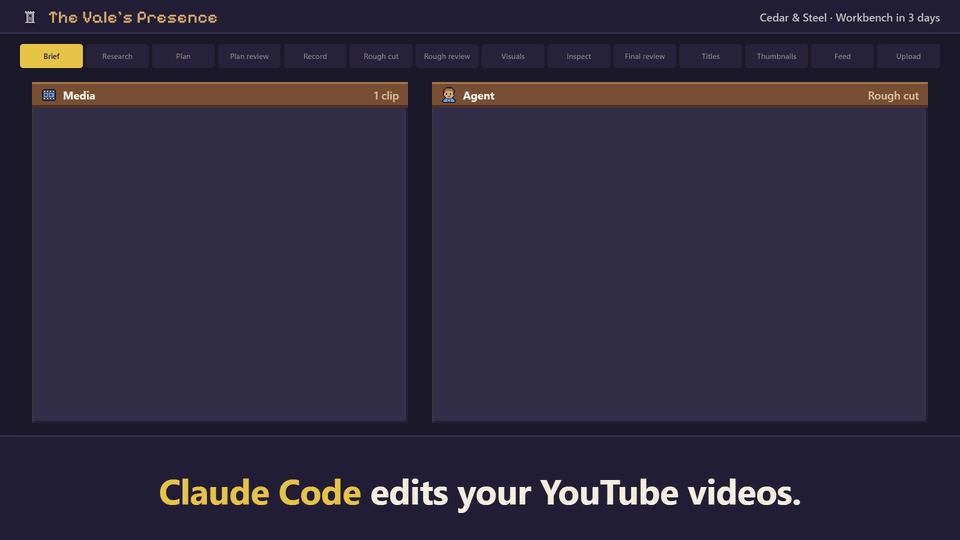

# The Vale's Presence

**Not another AI video editor. A YouTube studio run by agents on your own Claude Code subscription: they measure every cut, you approve the list, and once you approve the talk, nothing can change a word of it.**

You drop in footage. A Claude Code agent plans, cuts the rough, adds overlays, cuts Shorts, researches titles and thumbnails, makes thumbnail options and prepares the upload. You watch and decide on a screen laid out like a video editor, in a pixel-art frame.

[](https://vale.rokogrga.com/presence/)

*20 seconds on a made-up project. [Watch it with sound](docs/presence.mp4).*

## What it does

1. **The approved talk is locked.** "Approve & lock" hashes the rough. Nothing after it can change a word: a changed locked file halts the project with a clear message.
2. **Fixes take seconds.** The engine re-renders only the overlay windows and the stretches of the final that changed, and every step shows the time it took.
3. **Agents sleep while rendering.** A long render runs in the background and wakes the agent when it ends. Every step shows its time and its cost.
4. **The whole studio:** plan, script, record, edit, Shorts, title and thumbnail research, thumbnail options, a feed preview, upload.
5. **You control the agent's context:** every skill, rule and context file each stage reads, editable in place, with skills switched on and off per stage, plus a house rules book that learns from your corrections.
6. **Every cut is measured on the sound** and listed with Before / After clips, Keep / Restore / Note.
7. **Export** to MP4, SRT, FCPXML and OTIO.

## The numbers

Measured on real videos, on one Windows PC with an RTX 3060:

- **One label fixed in a finished 10-minute video: 36 s**, where re-rendering and re-checking by hand takes about an hour. One overlay window is drawn again and one of 39 chunks of the final is re-encoded.
- **A Short's round** (render the overlays, compose, check): **about a minute**.
- **The visuals round of a 10-minute video: 6.7 minutes of machine time instead of 70.** Still stretches of an overlay are drawn once and held, and the final is composed in cached chunks.

## Setup

```bash
git clone <this repository> the-vales-presence && cd the-vales-presence
npm install && npm install --prefix engine/remotion
npm start
```

`npm start` opens http://localhost:4848. If something the studio needs is missing, the app opens on its **Setup** tab, which checks every requirement and gives the command that fixes it for your system. Step by step for Windows, macOS and Linux: [docs/setup.md](docs/setup.md).

### Requirements

- **Node.js 22** or newer.
- **Claude Code**, logged in with your Claude account. The agents run on that login through the Claude Agent SDK: nothing else to pay for, no API key needed.
- **ffmpeg and ffprobe** on your PATH.
- **Python 3.10+ with numpy and Pillow**, and **uv** (it runs the speech-to-text and the word alignment, which fetch their own packages the first time).
- **Disk:** about 20 GB free for a long video's render cache.
- **A GPU is optional.** NVIDIA (NVENC and CUDA), Intel Quick Sync, AMD AMF and Apple VideoToolbox are found by themselves; without one the CPU encodes and transcribes, only slower.

## Quick start

After the [setup](docs/setup.md) and `npm install` above:

1. Run `npm start`. The server starts and **opens http://localhost:4848 in your browser by itself**. To keep the browser from opening, run `npm start -- --no-open` and open the address yourself.
2. If something is missing, the app opens on the **Setup** tab and shows the fix. Otherwise it opens the project you had open last, or the project picker when there is none.
3. Press the project picker at the top, name a new project, choose a recipe and press **Create**. Drop your footage into the Media panel and press **Go**. A tour of the whole screen: [docs/using.md](docs/using.md).

To stop the app, press Ctrl+C in the terminal where it runs. To update, stop it, then run `git pull` and `npm install` (and `npm install --prefix engine/remotion`), and start it again. Your projects and settings are in `data/`, which an update never touches. If the port is taken, `PRESENCE_PORT=4900 npm start` uses another: [docs/configuration.md](docs/configuration.md).

## How a project goes

Pick a recipe when you start a project: **Edit a video** (footage you have), **A video from the idea**, **Edit a Short**, or **Shorts from a long video** (the agent picks the moments, you keep or drop each as a 9:16 card, it cuts the ones you kept). A recipe is a list of stages, shown along the top as chips with the time and cost of each.

1. **Ask.** The agent asks what it needs and writes the brief.
2. **Research, plan, record** (A video from the idea only). Titles and thumbnails of videos like yours, a plan you approve, then you record.
3. **Rough cut.** The agent transcribes every word, measures the silences, fillers, retakes and asides, and cuts. Every join is checked on the sound so no word is clipped.
4. **Rough review.** You watch the rough, go through the cuts (flagged ones first) with Before / After, Keep, Restore or a note, and strike words in the transcript. Then **Approve & lock**, or send it back with your notes.
5. **Visuals.** Labels, cards, punch-ins, captions and sound on the locked rough, from an overlay kit (`kit/templates`). A proof first, then the final.
6. **Inspect.** The agent checks the final against a checklist: length, the locked voice, frames, text in the safe areas.
7. **Final review.** You approve or send back. A fix renders only what changed.
8. **Titles, thumbnails, feed.** Options as cards, with your thumbnail shown in a feed beside real ones.
9. **Upload and export.** Upload happens only when you press the button. Export gives the video, subtitles, and the edit list for other programs.

How the lock, the overlay windows, the cached chunks and the sleeping agent work: [docs/how-it-works.md](docs/how-it-works.md).

## Honest limits

- Tested on **Windows with an NVIDIA GPU** on real footage. macOS and Linux run (the app, the engine tests and the encoder fallbacks), but they have not been tried on real footage yet.
- The agents use your Claude subscription's limits. A long video's rough cut and visuals are several long turns; the cost of every stage is shown as it happens.
- Speech-to-text is tuned for English.
- The FCPXML and OTIO exports carry the cut (every kept stretch, linked to your footage), not the overlays.
- Overlays are React components rendered with Remotion; changing their look means editing a template's code (the agent can do it for you).

## Documentation

In reading order:

1. [Setup](docs/setup.md): install everything, for Windows, macOS and Linux, and what to do when something goes wrong.
2. [Using the app](docs/using.md): a tour of the screen, from a new project to export, and every keyboard shortcut.
3. [How it works](docs/how-it-works.md): stages, the lock, overlay windows and chunk caching, the sleeping agent.
4. [Configuration](docs/configuration.md): settings, environment variables, the engine config file, and where your data lives.
5. [Customising](docs/customising.md): your own recipes, skills, house rules and overlay templates.
6. [Thumbnails and AI images](docs/thumbnails-ai-images.md): optional AI backgrounds for thumbnails.
7. [Uploading to YouTube](docs/youtube-upload.md): the one-time Google setup.
8. [The engine](engine/README.md): the manual for the Python and ffmpeg engine.
9. [Contributing](CONTRIBUTING.md): tests, code style, reporting a bug.

## Folders

| folder | what |
|---|---|
| `server/` | the local server: projects, stages, the agent sessions, locks, media, export |
| `web/` | the screen: plain ES modules, no build step |
| `engine/` | the editing engine: Python and ffmpeg, Remotion for overlays |
| `craft/` | what the agent knows: instructions, recipes, skills, house rules |
| `kit/` | overlay templates, sound effects, caption fonts |
| `docs/` | the documentation, listed above |
| `data/` | your projects and settings (never committed) |

Tests: `npm test` (the server, the screen's logic and the engine) and `npm run test:engine` (the engine alone; needs Python with numpy and Pillow, and ffmpeg). More in [CONTRIBUTING.md](CONTRIBUTING.md).

## Made in The Vale

[Made in The Vale](https://vale.rokogrga.com).

## Licence

MIT (see `LICENSE`). Bundled fonts, the face model and other third-party parts are listed in `NOTICE`.
